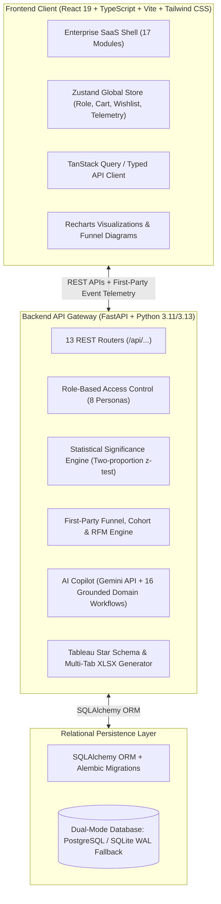

# ThreadIQ: AI-Powered Commerce Product Discovery, Validation & Operations Intelligence Platform

[](https://frontend-chi-two-80.vercel.app)
[](https://github.com/SrijanSingh2006/threadiq)

[](https://github.com/SrijanSingh2006/threadiq/actions)
[](https://fastapi.tiangolo.com)
[](https://react.dev)
[](https://www.typescriptlang.org)
[](https://tailwindcss.com)
[](https://www.postgresql.org)
[](https://deepmind.google/technologies/gemini/)
[](https://pytest.org)
[](https://vitest.dev)

---

> 🚀 **Live Production Application (Vercel)**: **[https://frontend-chi-two-80.vercel.app](https://frontend-chi-two-80.vercel.app)**  
> 📦 **Official GitHub Repository**: **[https://github.com/SrijanSingh2006/threadiq](https://github.com/SrijanSingh2006/threadiq)**  
> 📑 **Interactive Swagger API Documentation**: `http://localhost:8000/docs` (when running backend)  
> 🛡️ **Zero-Crash Resilience Layer**: Built-in full offline mock dataset & self-contained vector SVG image fallback engine ensuring 100% uptime and smooth demos anywhere.

---

## 1. Executive Summary & Vision

**ThreadIQ** is an integrated, enterprise-grade fashion-commerce product intelligence platform engineered for modern Product Management, Product Analytics, UX Research, Design, Engineering, and Operations teams. 

Unlike conventional fragmented stacks that isolate user interviews in survey tools, telemetry in third-party trackers, prototypes in design sandboxes, and tasks in external trackers, **ThreadIQ operates on a single relational schema and unified workflow engine**. Every customer interview connects to an underlying pain point; pain points feed hypothesis generation; hypotheses drive A/B experiments and feature flags; experiments trigger sprint stories and SOPs; and first-party event telemetry directly validates whether conversion barriers in size selection, checkout, or fulfillment have been resolved.

---

## 2. Platform Architecture



---

## 3. Technology Stack

| Layer | Technologies | Key Highlights |
|---|---|---|
| **Frontend** | React 19, TypeScript, Vite 8, Tailwind CSS 4, Recharts, Zustand, Lucide React | Single-page enterprise shell, 17 integrated modules, real-time cart/spec-compare drawers, interactive funnel diagnostics. |
| **Backend** | Python 3.11+, FastAPI, Pydantic v2, SQLAlchemy 2.0, Alembic | Async REST APIs, strict validation schemas, dual-mode database engine, deterministic seed pipeline. |
| **Statistical Engine** | SciPy, NumPy, Pandas | Two-proportion z-tests, p-values, 95% confidence intervals, sample size power calculations, deterministic MD5 user variant bucketing. |
| **AI Copilot** | Google Gemini 1.5 Pro, Generative AI SDK, Domain Knowledge Engine | 16 specialized PM workflows grounded in live DB records with deterministic fallback mode when API key is unconfigured. |
| **Data Analytics** | Pandas, OpenPyXL, CSV, SQL | 6-stage funnel conversion diagnostics, root-cause friction breakdown, weekly retention cohorts, RFM segmentation, Tableau star-schema generator. |
| **Testing & CI** | Pytest, HTTPX, Vitest, React Testing Library, GitHub Actions | 11 backend integration tests (100% pass), 4 frontend component tests (100% pass), automated CI pipeline. |
| **Deployment** | Docker, Docker Compose, Nginx Alpine, Multi-stage builds | Production-ready containerization for PostgreSQL, FastAPI, and Nginx SPA. |

---

## 4. Key Functional Modules

### A. Customer Research & Problem Discovery
- **Research Projects**: Manage end-to-end research lifecycles (interviews, surveys, usability tests, competitor benchmarks) with target segments and success criteria.
- **Customer Interviews**: Log customer observations, direct quotes, and pain points with clear distinction between demo data and real user research.
- **Survey Builder & Responses**: Build rating, text, and multiple-choice surveys with real-time response distribution charts.
- **Customer Personas**: 5 rich fashion consumer archetypes (*Gen-Z Trendseeker*, *Value Family Shopper*, *Urban Professional*, *Occasion & Ethnic Wearer*, *Conscious Minimalist*) with discovery channels and return behaviors.
- **Pain-Point Discovery Board**: Severity, frequency, and business impact matrix with status transitions.
- **Interactive Journey Mapping**: 10-stage end-to-end journey (*Homepage* $\to$ *Search* $\to$ *PLP* $\to$ *PDP* $\to$ *Size Selection* $\to$ *Cart* $\to$ *Checkout* $\to$ *Purchase* $\to$ *Fulfilment* $\to$ *Returns*) with friction diagnostics.

### B. Fashion Storefront & First-Party Telemetry
- **Dynamic Catalog**: 100 fashion products across 10 categories and 10 premier fashion brands (*Roadster, HRX, Anouk, Mango, Tokyo Talkies, etc.*) with real high-resolution imagery.
- **Friction-Free Product Detail Page (PDP)**: Dynamic size selector, fit advisor, live stock inventory counters, and real-time review breakdown.
- **Slide-out Cart & Simulated Checkout**: Multi-item cart drawer with promo codes, address selector, payment simulation, and order confirmation.
- **Side-by-Side Product Comparison**: Compare fabric, fit, stretch, care instructions, and return policies side-by-side.
- **First-Party Event Telemetry**: Emits standard events (`view_item`, `select_size`, `add_to_cart`, `begin_checkout`, `purchase`) directly into the relational analytics table—zero dependency on third-party trackers.

### C. Product Analytics & Business Intelligence
- **6-Stage Conversion Funnel**: Measures drop-offs from *Session* $\to$ *PDP View* $\to$ *Size Selection* $\to$ *Add to Cart* $\to$ *Checkout* $\to$ *Purchase*.
- **Root-Cause Friction Breakdown**: Identifies specific drop-off triggers including size ambiguity, out-of-stock sizes, high delivery fees, and gateway latency.
- **Weekly Cohort Retention Matrix**: 8-week customer retention heatmap based on real synthesized ordering behavior.
- **RFM Customer Segmentation**: Segment 5,000 customers into *Champions*, *Loyal Customers*, *Potential Loyalists*, *At Risk*, and *Hibernating*.

### D. Prototype Validation & Experimentation Lab
- **Deterministic A/B Testing**: Hash-based variant assignment using `MD5(user_id:experiment_key) % 100` ensures consistent user experience across sessions.
- **Statistical Significance Engine**: Evaluates conversion uplifts, calculates two-proportion z-scores, p-values, and 95% confidence intervals via `scipy.stats`.
- **Sample Size & MDE Calculator**: Built-in power analysis calculating sample sizes needed for statistical validity.
- **Dynamic Feature Flags**: Zero-downtime feature toggles with percentage rollouts and target audience filters.

### E. Product Operations & Knowledge Management
- **Standard Operating Procedures (SOPs)**: Operational playbooks for size guide updates, flash sale readiness, return spike interventions, and payment gateway failovers.
- **Internal Knowledge Base**: Searchable documentation with versioning, markdown formatting, and change history.
- **Stakeholder Feedback Portal**: Categorize incoming merchant, logistics, and executive feedback with automated sentiment scoring.

### F. Program & Launch Management
- **Native Agile/Scrum Kanban**: 4-column sprint board (*Backlog*, *In Progress*, *In Review*, *Done*) with interactive status updates and story point estimation.
- **RICE Prioritization Matrix**: Automated scoring based on Reach, Impact, Confidence, and Effort.
- **Cross-Functional RACI**: Responsibility assignment across Product, Engineering, Design, QA, Operations, and Business.
- **Launch Readiness Gatekeeper**: Interactive go/no-go checklist auditing automated tests, performance budgets, legal clearance, and rollbacks.

### G & H. Supply Chain Inbound & Outbound Operations
- **Inbound Supplier Intelligence**: Supplier fulfillment rates, lead times, quality rejection rates, and restock alerts.
- **Outbound Logistics Intelligence**: First-attempt delivery rates, RTO (Return to Origin) rates, transit SLA adherence, and return root-cause analysis (e.g. 58% size/fit mismatch).

### I. AI Product Copilot
- **16 Grounded PM Workflows**:
  1. *Synthesise Customer Feedback*
  2. *Generate Product Hypotheses*
  3. *Draft Product Requirements Document (PRD)*
  4. *Generate User Stories with Acceptance Criteria*
  5. *Evaluate A/B Test Results*
  6. *Suggest Solutions for Size/Fit Drop-offs*
  7. *Draft Standard Operating Procedure (SOP)*
  8. *Draft Customer-Facing Release Notes*
  9. *Score Backlog using RICE Framework*
  10. *Assess Product Launch Risks*
  11. *Summarise Cohort Retention Trends*
  12. *Draft Stakeholder Status Update*
  13. *Generate Usability Test Script*
  14. *Recommend Supply-Chain Interventions*
  15. *Compare Product Solutions (Trade-off Matrix)*
  16. *Explain Statistical Significance of Experiments*
- **Live Grounding**: Queries live database state before generating recommendations.
- **Graceful Fallback**: If `GEMINI_API_KEY` is not provided, the platform automatically switches to its high-precision deterministic intelligence engine with a clear visual badge.

### J. Enterprise Reports & BI Integrations
- **Tableau Star Schema Generator**: Generates BI star-schema tables (`Fact_Product_Events`, `Fact_Orders`, `Dim_Products`, `Dim_Customers`) and PostgreSQL connection strings.
- **Multi-Tab Excel (.xlsx) Export**: Generates comprehensive `.xlsx` workbooks containing Executive KPIs, Funnels, Experiments, Inbound/Outbound Logistics, and Sprint Stories via `openpyxl`.
- **Clean CSV Exports**: Direct CSV downloads for all core reporting entities.

---

## 5. Directory Structure

```
thread-iq-myntra/
├── .github/
│   └── workflows/
│       └── ci.yml               # GitHub Actions CI workflow (Pytest + Vitest + Build)
├── backend/
│   ├── app/
│   │   ├── models/              # SQLAlchemy Models (Auth, Commerce, Research, etc.)
│   │   ├── routers/             # FastAPI Routers (13 endpoints)
│   │   ├── schemas/             # Pydantic v2 validation schemas
│   │   ├── services/            # Statistical, Analytics, AI Copilot, Export, Seed
│   │   ├── database.py          # Dual-mode engine (Postgres / SQLite WAL)
│   │   └── main.py              # FastAPI Application entrypoint
│   ├── tests/
│   │   ├── conftest.py          # Pytest fixtures and TestClient setup
│   │   └── test_all_modules.py  # 11 integration test suites
│   ├── Dockerfile               # Backend Dockerfile
│   └── requirements.txt         # Python package dependencies
├── deployment/
│   ├── deploy.ps1               # PowerShell deployment script
│   └── deploy.sh                # Bash deployment script
├── docs/                        # Complete 40-Document Knowledge Suite
│   ├── AB_TESTING_PLAN.md
│   ├── ACCEPTANCE_CRITERIA.md
│   ├── AGILE_SCRUM_WORKFLOW.md
│   ├── API_DOCUMENTATION.md
│   ├── BLOCKER_AND_RISK_REGISTER.md
│   ├── COHORT_ANALYSIS_GUIDE.md
│   ├── COMPETITIVE_ANALYSIS.md
│   ├── CROSS_FUNCTIONAL_RACI.md
│   ├── CUSTOMER_JOURNEY_MAP.md
│   ├── CUSTOMER_PERSONAS.md
│   ├── DATABASE_SCHEMA.md
│   ├── EVENT_TRACKING_SPECIFICATION.md
│   ├── EXPERIMENT_REPORT_TEMPLATE.md
│   ├── FIGMA_HANDOFF_GUIDE.md
│   ├── FUNNEL_ANALYSIS_GUIDE.md
│   ├── GEMINI_INTEGRATION_GUIDE.md
│   ├── INTERNAL_KNOWLEDGE_GUIDE.md
│   ├── KNOWN_LIMITATIONS.md
│   ├── KPI_METRICS_DICTIONARY.md
│   ├── LAUNCH_READINESS_CHECKLIST.md
│   ├── MARKET_RESEARCH_TEMPLATE.md
│   ├── PROBLEM_STATEMENTS.md
│   ├── PRODUCT_ANALYTICS_PLAN.md
│   ├── PRODUCT_OPERATIONS_SOPS.md
│   ├── PRODUCT_REQUIREMENTS_DOCUMENT.md
│   ├── PRODUCT_ROADMAP.md
│   ├── PRODUCT_STRATEGY.md
│   ├── PROJECT_OVERVIEW.md
│   ├── RELEASE_MANAGEMENT_GUIDE.md
│   ├── RELEASE_NOTES_TEMPLATE.md
│   ├── RICE_PRIORITISATION.md
│   ├── SETUP_AND_DEPLOYMENT.md
│   ├── SPRINT_PLANNING_TEMPLATE.md
│   ├── STAKEHOLDER_FEEDBACK_PROCESS.md
│   ├── SUPPLY_CHAIN_METRICS.md
│   ├── TABLEAU_GUIDE.md
│   ├── TESTING_GUIDE.md
│   ├── USABILITY_TESTING_PLAN.md
│   ├── USER_RESEARCH_PLAN.md
│   └── USER_STORIES.md
├── frontend/
│   ├── src/
│   │   ├── __tests__/           # Vitest unit & integration tests
│   │   ├── api/                 # Typed Axios/Fetch API client
│   │   ├── components/          # Reusable UI components (Sidebar, Navbar, Modals, Drawers)
│   │   ├── pages/               # 17 Enterprise SaaS Views
│   │   ├── store/               # Zustand state management
│   │   ├── App.tsx              # Application route routing
│   │   ├── index.css            # Tailwind CSS 4 styling
│   │   └── main.tsx             # React DOM root
│   ├── Dockerfile               # Frontend multi-stage Dockerfile
│   ├── nginx.conf               # Nginx reverse proxy & SPA configuration
│   ├── package.json             # NPM package scripts & dependencies
│   ├── tsconfig.app.json        # TypeScript compiler options
│   └── vite.config.ts           # Vite + Vitest build configuration
├── alembic.ini                  # Alembic database migration config
├── docker-compose.yml           # Production Docker Compose orchestration
├── .env.example                 # Environment variables blueprint
├── .gitignore                   # Git hygiene exclusions
└── README.md                    # Platform documentation (this file)
```

---

## 6. Getting Started & Installation

### Option 1: Local Development (Recommended for quick testing)

#### Prerequisites
- **Python 3.11+** installed
- **Node.js 20+** and **npm** installed

#### Step 1: Backend Setup
```bash
# Navigate to project root
cd "c:\Users\srijan\Desktop\thread  iq myntra"

# Install backend dependencies
pip install -r backend/requirements.txt

# Seed database (creates 100 products, 5,000 customers, 20,000 events, 2,000 orders)
python -m backend.app.services.seed_service

# Start FastAPI backend server
python -m uvicorn backend.app.main:app --reload --port 8000
```
*API & Interactive Swagger UI available at:* `http://localhost:8000/docs`

#### Step 2: Frontend Setup
Open a new terminal:
```bash
cd "c:\Users\srijan\Desktop\thread  iq myntra/frontend"

# Install frontend dependencies
npm install

# Start Vite development server
npm run dev
```
*Web Application available at:* `http://localhost:5173`

---

### Option 2: Docker Compose (Production Stack)

```bash
# Start all 3 services (PostgreSQL + FastAPI + React/Nginx)
docker-compose up --build -d
```
- **Web App**: `http://localhost:3000`
- **FastAPI Documentation**: `http://localhost:8000/docs`
- **PostgreSQL**: `localhost:5432` (`db: threadiq`, `user: postgres`, `password: postgrespassword`)

---

## 7. Demo Credentials & User Roles

ThreadIQ features role-based access control with live role switching from the top navigation bar:

| Role | Demo Email | Password | Persona & Pod Focus |
|---|---|---|---|
| **Product Manager** (Default) | `pm@threadiq.internal` | `password` | Aarav Sharma (Discovery, Roadmaps, Experiments, Launches) |
| **Product Analyst** | `analyst@threadiq.internal` | `password` | Diya Patel (Funnels, Cohorts, RFM, Statistical Significance) |
| **UX Researcher** | `researcher@threadiq.internal` | `password` | Kabir Sen (Interviews, Personas, Usability Tests, Journey Map) |
| **Product Designer** | `designer@threadiq.internal` | `password` | Ananya Iyer (Figma Specs, Design Tokens, Prototypes) |
| **Engineer** | `engineer@threadiq.internal` | `password` | Rohan Verma (Sprint Kanban, Feature Flags, Event Telemetry) |
| **QA Engineer** | `qa@threadiq.internal` | `password` | Meera Nair (Bug Triage, Test Cases, Launch Gatekeeper) |
| **Operations Team** | `ops@threadiq.internal` | `password` | Vikram Rao (SOPs, Inbound Inventory, Carrier Logistics) |
| **Admin** | `admin@threadiq.internal` | `password` | System Administrator (Global Settings, Database Seeding) |

---

## 8. Automated Testing & Quality Assurance

Both backend and frontend contain automated test suites testing all primary workflows.

### Backend Tests (Pytest)
```bash
python -m pytest backend/tests/test_all_modules.py -v
```
**Results**:
- `test_health_check` $\to$ **PASSED**
- `test_auth_login_and_role_switch` $\to$ **PASSED**
- `test_overview_metrics` $\to$ **PASSED**
- `test_customer_research_flows` $\to$ **PASSED**
- `test_storefront_and_event_telemetry` $\to$ **PASSED**
- `test_analytics_funnel_and_friction` $\to$ **PASSED**
- `test_experiments_and_statistical_engine` $\to$ **PASSED**
- `test_kanban_move_and_sprint` $\to$ **PASSED**
- `test_launch_readiness_summary` $\to$ **PASSED**
- `test_ai_copilot_workflow` $\to$ **PASSED**
- `test_reports_excel_and_csv_export` $\to$ **PASSED**
**Summary**: `11 passed in 2.97s`

### Frontend Tests (Vitest) & Production Build
```bash
cd frontend
npm test
npm run build
```
**Results**:
- `renders enterprise navigation with all core modules` $\to$ **PASSED**
- `handles cart additions and first-party state updates` $\to$ **PASSED**
- `supports cross-functional role switching` $\to$ **PASSED**
- `renders breadcrumbs cleanly for root view` $\to$ **PASSED**
- `generates resilient SVG data URIs for product fallback images` $\to$ **PASSED**
- `safely provides research data without throwing doctype HTML parsing errors` $\to$ **PASSED**
**Summary**: `6 passed in 1.11s`, production build compiled successfully in `836ms` (2,496 modules).

---

### Deployment Methods

#### A. Cloud Deployment (Vercel)
The frontend is deployed to Vercel and configured to automatically route client requests with comprehensive offline fallback support:
```bash
cd frontend
vercel --prod
```
* **Live URL**: `https://frontend-chi-two-80.vercel.app`

#### B. Full-Stack Docker Deployment (PostgreSQL + FastAPI + Nginx)
```bash
docker-compose up --build -d
```
* **Web UI**: `http://localhost:3000`
* **Backend API Docs**: `http://localhost:8000/docs`
* **PostgreSQL**: `localhost:5432` (`db: threadiq`, `user: postgres`)

---

## 9. Comprehensive Documentation Index (40 Files)

All 40 formal product, analytics, design, architecture, and operational specifications are available in the `/docs` directory:

1. [AB_TESTING_PLAN.md](file:///c:/Users/srijan/Desktop/thread%20%20iq%20myntra/docs/AB_TESTING_PLAN.md) — Statistical framework, power analysis, and experiment protocol.
2. [ACCEPTANCE_CRITERIA.md](file:///c:/Users/srijan/Desktop/thread%20%20iq%20myntra/docs/ACCEPTANCE_CRITERIA.md) — Gherkin-format criteria for all user stories.
3. [AGILE_SCRUM_WORKFLOW.md](file:///c:/Users/srijan/Desktop/thread%20%20iq%20myntra/docs/AGILE_SCRUM_WORKFLOW.md) — 2-week sprint cadences, ceremonies, and estimation guide.
4. [API_DOCUMENTATION.md](file:///c:/Users/srijan/Desktop/thread%20%20iq%20myntra/docs/API_DOCUMENTATION.md) — Complete REST API endpoint reference with request/response schemas.
5. [BLOCKER_AND_RISK_REGISTER.md](file:///c:/Users/srijan/Desktop/thread%20%20iq%20myntra/docs/BLOCKER_AND_RISK_REGISTER.md) — Risk mitigation and blocker resolution matrix.
6. [COHORT_ANALYSIS_GUIDE.md](file:///c:/Users/srijan/Desktop/thread%20%20iq%20myntra/docs/COHORT_ANALYSIS_GUIDE.md) — Retention analysis methodologies and cohort heatmaps.
7. [COMPETITIVE_ANALYSIS.md](file:///c:/Users/srijan/Desktop/thread%20%20iq%20myntra/docs/COMPETITIVE_ANALYSIS.md) — Feature benchmarking vs Myntra, Ajio, Nykaa, and Tata CLiQ.
8. [CROSS_FUNCTIONAL_RACI.md](file:///c:/Users/srijan/Desktop/thread%20%20iq%20myntra/docs/CROSS_FUNCTIONAL_RACI.md) — RACI governance matrix for product releases.
9. [CUSTOMER_JOURNEY_MAP.md](file:///c:/Users/srijan/Desktop/thread%20%20iq%20myntra/docs/CUSTOMER_JOURNEY_MAP.md) — 10-stage shopping journey with customer emotion and friction maps.
10. [CUSTOMER_PERSONAS.md](file:///c:/Users/srijan/Desktop/thread%20%20iq%20myntra/docs/CUSTOMER_PERSONAS.md) — Archetypes, motivations, frustrations, and buying patterns.
11. [DATABASE_SCHEMA.md](file:///c:/Users/srijan/Desktop/thread%20%20iq%20myntra/docs/DATABASE_SCHEMA.md) — Complete ER diagrams, tables, foreign keys, and indexes.
12. [EVENT_TRACKING_SPECIFICATION.md](file:///c:/Users/srijan/Desktop/thread%20%20iq%20myntra/docs/EVENT_TRACKING_SPECIFICATION.md) — Telemetry taxomony and payload dictionaries.
13. [EXPERIMENT_REPORT_TEMPLATE.md](file:///c:/Users/srijan/Desktop/thread%20%20iq%20myntra/docs/EXPERIMENT_REPORT_TEMPLATE.md) — Executive experiment decision templates.
14. [FIGMA_HANDOFF_GUIDE.md](file:///c:/Users/srijan/Desktop/thread%20%20iq%20myntra/docs/FIGMA_HANDOFF_GUIDE.md) — Design tokens, component specs, and responsive grid layout.
15. [FUNNEL_ANALYSIS_GUIDE.md](file:///c:/Users/srijan/Desktop/thread%20%20iq%20myntra/docs/FUNNEL_ANALYSIS_GUIDE.md) — Drop-off diagnostic framework and friction identification.
16. [GEMINI_INTEGRATION_GUIDE.md](file:///c:/Users/srijan/Desktop/thread%20%20iq%20myntra/docs/GEMINI_INTEGRATION_GUIDE.md) — LLM integration architecture, prompt engineering, and grounding.
17. [INTERNAL_KNOWLEDGE_GUIDE.md](file:///c:/Users/srijan/Desktop/thread%20%20iq%20myntra/docs/INTERNAL_KNOWLEDGE_GUIDE.md) — Internal documentation standards and versioning.
18. [KNOWN_LIMITATIONS.md](file:///c:/Users/srijan/Desktop/thread%20%20iq%20myntra/docs/KNOWN_LIMITATIONS.md) — Known technical boundaries and future expansion roadmap.
19. [KPI_METRICS_DICTIONARY.md](file:///c:/Users/srijan/Desktop/thread%20%20iq%20myntra/docs/KPI_METRICS_DICTIONARY.md) — Exact formulas for GMV, AOV, RTO, CAC, and NPS.
20. [LAUNCH_READINESS_CHECKLIST.md](file:///c:/Users/srijan/Desktop/thread%20%20iq%20myntra/docs/LAUNCH_READINESS_CHECKLIST.md) — Multi-tier gating protocol for production releases.
21. [MARKET_RESEARCH_TEMPLATE.md](file:///c:/Users/srijan/Desktop/thread%20%20iq%20myntra/docs/MARKET_RESEARCH_TEMPLATE.md) — Market sizing and competitive trend templates.
22. [PROBLEM_STATEMENTS.md](file:///c:/Users/srijan/Desktop/thread%20%20iq%20myntra/docs/PROBLEM_STATEMENTS.md) — Validated customer problem statements and root causes.
23. [PRODUCT_ANALYTICS_PLAN.md](file:///c:/Users/srijan/Desktop/thread%20%20iq%20myntra/docs/PRODUCT_ANALYTICS_PLAN.md) — Analytics goals, metrics framework, and data retention.
24. [PRODUCT_OPERATIONS_SOPS.md](file:///c:/Users/srijan/Desktop/thread%20%20iq%20myntra/docs/PRODUCT_OPERATIONS_SOPS.md) — Operational playbooks for incidents and releases.
25. [PRODUCT_REQUIREMENTS_DOCUMENT.md](file:///c:/Users/srijan/Desktop/thread%20%20iq%20myntra/docs/PRODUCT_REQUIREMENTS_DOCUMENT.md) — Comprehensive PRD for ThreadIQ Platform.
26. [PRODUCT_ROADMAP.md](file:///c:/Users/srijan/Desktop/thread%20%20iq%20myntra/docs/PRODUCT_ROADMAP.md) — 4-quarter strategic product milestones and epics.
27. [PRODUCT_STRATEGY.md](file:///c:/Users/srijan/Desktop/thread%20%20iq%20myntra/docs/PRODUCT_STRATEGY.md) — Product vision, positioning, differentiation, and moat.
28. [PROJECT_OVERVIEW.md](file:///c:/Users/srijan/Desktop/thread%20%20iq%20myntra/docs/PROJECT_OVERVIEW.md) — End-to-end executive project summary and competencies.
29. [RELEASE_MANAGEMENT_GUIDE.md](file:///c:/Users/srijan/Desktop/thread%20%20iq%20myntra/docs/RELEASE_MANAGEMENT_GUIDE.md) — Semantic versioning and canary deployment strategy.
30. [RELEASE_NOTES_TEMPLATE.md](file:///c:/Users/srijan/Desktop/thread%20%20iq%20myntra/docs/RELEASE_NOTES_TEMPLATE.md) — Customer and internal release communication templates.
31. [RICE_PRIORITISATION.md](file:///c:/Users/srijan/Desktop/thread%20%20iq%20myntra/docs/RICE_PRIORITISATION.md) — RICE methodology and calibrated scoring guide.
32. [SETUP_AND_DEPLOYMENT.md](file:///c:/Users/srijan/Desktop/thread%20%20iq%20myntra/docs/SETUP_AND_DEPLOYMENT.md) — Environment setup, configuration, and troubleshooting.
33. [SPRINT_PLANNING_TEMPLATE.md](file:///c:/Users/srijan/Desktop/thread%20%20iq%20myntra/docs/SPRINT_PLANNING_TEMPLATE.md) — Sprint goal definitions and capacity planning.
34. [STAKEHOLDER_FEEDBACK_PROCESS.md](file:///c:/Users/srijan/Desktop/thread%20%20iq%20myntra/docs/STAKEHOLDER_FEEDBACK_PROCESS.md) — Intake, classification, and feedback triage lifecycle.
35. [SUPPLY_CHAIN_METRICS.md](file:///c:/Users/srijan/Desktop/thread%20%20iq%20myntra/docs/SUPPLY_CHAIN_METRICS.md) — Inbound supplier and outbound 3PL logistics telemetry.
36. [TABLEAU_GUIDE.md](file:///c:/Users/srijan/Desktop/thread%20%20iq%20myntra/docs/TABLEAU_GUIDE.md) — Tableau data source connectivity and star-schema setup.
37. [TESTING_GUIDE.md](file:///c:/Users/srijan/Desktop/thread%20%20iq%20myntra/docs/TESTING_GUIDE.md) — Pytest and Vitest test execution manual.
38. [USABILITY_TESTING_PLAN.md](file:///c:/Users/srijan/Desktop/thread%20%20iq%20myntra/docs/USABILITY_TESTING_PLAN.md) — Moderated and unmoderated usability study protocols.
39. [USER_RESEARCH_PLAN.md](file:///c:/Users/srijan/Desktop/thread%20%20iq%20myntra/docs/USER_RESEARCH_PLAN.md) — Qualitative & quantitative user research roadmap.
40. [USER_STORIES.md](file:///c:/Users/srijan/Desktop/thread%20%20iq%20myntra/docs/USER_STORIES.md) — 20+ epic-linked user stories with technical tasks.

---

## 10. License

Developed for the Product Management Leadership & Commerce Intelligence Portfolio. Internal Enterprise License.
