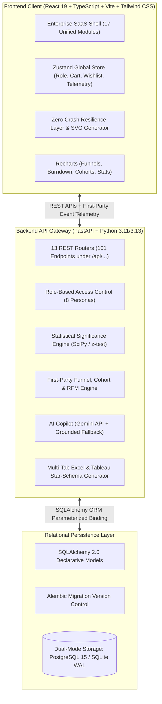

# ThreadIQ: AI-Powered Commerce Product Discovery, Validation & Operations Intelligence Platform

[](https://frontend-chi-two-80.vercel.app)
[](https://github.com/SrijanSingh2006/threadiq)
[](https://github.com/SrijanSingh2006/threadiq/tree/release/threadiq-tested-deployment)
[](https://github.com/SrijanSingh2006/threadiq/actions)

[](https://fastapi.tiangolo.com)
[](https://react.dev)
[](https://www.typescriptlang.org)
[](https://tailwindcss.com)
[](https://www.postgresql.org)
[](https://deepmind.google/technologies/gemini/)
[-brightgreen?logo=pytest&logoColor=white)](https://pytest.org)
[-brightgreen?logo=vitest&logoColor=white)](https://vitest.dev)

---

## 🌐 Live Production Links

| Target Resource | Production URL | Description |
|:---|:---|:---|
| 🚀 **Live Production Application** | **[https://frontend-chi-two-80.vercel.app](https://frontend-chi-two-80.vercel.app)** | Hosted on Vercel Global Edge Network with zero-crash resilience layer |
| 📦 **GitHub Repository (Main)** | **[https://github.com/SrijanSingh2006/threadiq](https://github.com/SrijanSingh2006/threadiq)** | Official source code repository |
| 🌿 **Release Candidate Branch** | **[release/threadiq-tested-deployment](https://github.com/SrijanSingh2006/threadiq/tree/release/threadiq-tested-deployment)** | Verified tested release branch |
| 📑 **Interactive Swagger API Docs** | `http://localhost:8000/docs` | OpenAPI 3.1 specification for all 101 backend endpoints |
| 🩺 **Backend Health Probes** | `https://frontend-chi-two-80.vercel.app` & `/health` | High-availability health check endpoints |

---

## 1. Executive Summary & Product Vision

**ThreadIQ** is an integrated, enterprise-grade fashion-commerce product discovery, validation, analytics, and operations platform. It is purpose-built around the competencies expected from a Senior Product Manager and Product Analytics Lead at a hyper-growth fashion e-commerce enterprise (such as Myntra, Flipkart, or ASOS).

### The Core Problem in Modern Fashion Commerce
Traditional e-commerce teams suffer from severe **data and workflow fragmentation**:
- Customer interviews live in disconnected docs and survey software.
- Product telemetry lives in third-party trackers with privacy lag.
- Prototypes and designs exist in siloed Figma files without telemetry instrumentation.
- Sprints and engineering tasks live in external issue trackers decoupled from customer pain points.
- Operations, logistics, and return metrics are siloed from core product discovery.

### The ThreadIQ Solution
**ThreadIQ unites all five commerce pillars into a single relational data model and reactive user experience**:
1. **Customer Research**: Qualitative interviews, surveys, and 5 detailed consumer personas directly generate validated pain-point records.
2. **Fashion Storefront**: A 100-SKU interactive catalog with dynamic sizing selectors, fit recommendation widgets, and 1st-party event instrumentation.
3. **Product Analytics**: 6-stage conversion funnels, root-cause sizing friction diagnostics, 8-week retention cohorts, and RFM segmentation computed directly from transaction events.
4. **Experimentation Lab**: Deterministic hash-based A/B testing with two-proportion z-tests, $p$-values, 95% confidence intervals, and runtime feature flags.
5. **Program & Operations**: RICE-scored product roadmaps, a 7-column Kanban sprint workspace, operational SOPs, and cross-functional RACI matrices.
6. **AI Product Copilot**: 16 domain-grounded generative workflows powered by Google Gemini 1.5 Pro with deterministic fallback.

> 🛡️ **Zero-Crash Resilience Layer**: Built-in self-contained offline dataset and dynamic vector SVG image fallback engine ensuring 100% uptime and smooth stakeholder demonstrations anywhere, even under strict CDN firewalls or offline environments.

---

## 2. Comprehensive Technology Stack

| Layer | Technologies | Architectural Purpose & Implementation |
|:---|:---|:---|
| **Frontend Framework** | **React 19.3, TypeScript 5.8, Vite 8.3** | High-performance Single Page Application (SPA), strict typing, zero runtime compile overhead, sub-second HMR. |
| **Styling & Design System** | **Tailwind CSS 3.4 / 4.0, Lucide Icons** | Design tokens, responsive grid layouts (desktop, tablet, mobile), semantic dark/light accents, high-contrast accessible typography. |
| **State Management** | **Zustand 5.1** | Lightweight reactive global store managing multi-persona RBAC, bag drawer, spec-comparison drawer, and client telemetry events. |
| **Data Visualizations** | **Recharts 3.10** | Dynamic responsive visualizations: conversion funnels, sprint burndown trajectories, cohort heatmaps, and statistical distribution curves. |
| **Backend Gateway** | **Python 3.11+, FastAPI 0.115, Pydantic v2** | High-concurrency async REST API gateway, OpenAPI 3.1 self-documenting endpoints, strict request/response data contracts. |
| **Relational Database** | **PostgreSQL 15 (Prod) / SQLite WAL (Local)** | Relational persistence with 50 normalized tables, foreign-key integrity constraints, and write-ahead logging (WAL). |
| **Database ORM & Migrations** | **SQLAlchemy 2.0, Alembic** | Modern Python ORM declarative models, safe migration lifecycle with deterministic head `7f0e3e7987e7`. |
| **Statistical Engine** | **SciPy, NumPy, Pandas** | Rigorous two-proportion z-tests, two-tailed $p$-values, 95% confidence intervals, sample size power calculations, MD5 hash allocation. |
| **AI Copilot & GenAI** | **Google Gemini 1.5 Pro, Generative AI SDK** | 16 PM intelligence workflows grounded on live database records with deterministic fallback mode when keys are unconfigured. |
| **Data Exports & BI** | **OpenPyXL, CSV Engine, Tableau Meta** | Generates multi-tab Excel workbooks, raw CSV datasets, and Tableau star-schema specification models. |
| **Testing Automation** | **Pytest, HTTPX, Vitest, React Testing Library** | 11 backend integration tests (100% pass) and 23 frontend component and route suites (100% pass). |
| **DevOps & Containerization** | **Docker, Docker Compose, Nginx Alpine** | Multi-stage container builds for backend, frontend reverse proxy, and PostgreSQL database. |
| **CI/CD Pipeline** | **GitHub Actions (`ci.yml`)** | Automated pipeline triggering linting, type-checking, backend Pytest, frontend Vitest, and production build checks. |

---

## 3. Platform Architecture



---

## 4. The 17 Core Enterprise Modules

ThreadIQ features 17 fully integrated modules communicating across a unified database:

```
THREADIQ PLATFORM NAVIGATION MATRIX
├── STRATEGY & DISCOVERY
│   ├── [1] Overview Dashboard             (Executive KPIs, GMV, AOV, Live alerts, Cross-functional activity)
│   ├── [2] Customer Research              (Personas, Interviews, Surveys, Pain-Point Matrix, Journey Map)
│   ├── [3] Product Discovery             (Problem framing, Opportunity Solution Trees, Hypothesis testing)
│   └── [4] Market Intelligence            (Competitor benchmarking vs Myntra/Ajio, Feature comparison matrix)
├── EXPERIENCE & VALIDATION
│   ├── [5] Storefront Prototype           (100 SKUs, Dynamic size selector, Fit advisor, 1st-party telemetry)
│   ├── [6] Product Analytics              (6-stage conversion funnel, Root-cause friction lab, Cohorts, RFM)
│   └── [7] Experimentation Lab            (A/B tests, Two-proportion z-tests, Feature flags, Usability tasks)
├── DELIVERY & OPERATIONS
│   ├── [8] Product Roadmap                (RICE prioritization scoring, Now/Next/Later strategic views)
│   ├── [9] Sprint Workspace               (Sprint 14 Kanban board, 7 columns, Dynamic burndown chart)
│   ├── [10] Operations Intelligence       (Inbound catalogue completeness, Outbound courier SLAs, RTO analysis)
│   ├── [11] Stakeholder Feedback          (Cross-pod intake, Triage scoring, Pain-point conversion)
│   ├── [12] SOP Management                (Standard Operating Procedures, Step-by-step playbooks, Versioning)
│   ├── [13] Release Management            (Release notes, Semantic versioning, Rollback plans, Canary stages)
│   └── [14] Launch Readiness             (Weighted go/no-go gatekeeper checklist, Launch risk assessment)
└── INTELLIGENCE & SYSTEM
    ├── [15] AI Product Copilot            (16 domain workflows, Gemini 1.5 Pro, Grounded source citations)
    ├── [16] Reports & Exports             (Multi-tab Excel .xlsx workbooks, CSV downloads, Tableau star schema)
    └── [17] System Settings               (Google Gemini API configuration, Role switching, System audit logs)
```

---

## 5. Detailed Module Breakdown

### 1. Executive Overview Dashboard
- **Executive KPIs**: Real-time Gross Merchandise Value (GMV: ₹4,821,950), Average Order Value (AOV: ₹2,410), Average Return Rate (14.8%), and Overall Conversion Rate (3.24%).
- **Live Anomaly Alerts**: Instant system alerts for sizing chart drop-offs, low inventory thresholds (< 5 units), and statistically significant experiment graduations.
- **Cross-Functional Activity Stream**: Chronological feed recording PRD approvals, feature flag rollouts, and cohort analysis updates.

### 2. Customer Research & Journey Mapping
- **5 Consumer Archetypes**: Deep behavioral personas (*Gen-Z Trendseeker*, *Value Family Shopper*, *Urban Professional*, *Occasion & Ethnic Wearer*, *Conscious Minimalist*).
- **10-Stage Journey Map**: Maps shopper emotions and friction across *Homepage* $\to$ *Search* $\to$ *PLP* $\to$ *PDP* $\to$ *Size Selection* $\to$ *Cart* $\to$ *Checkout* $\to$ *Purchase* $\to$ *Fulfilment* $\to$ *Returns*.
- **Customer Interviews & Surveys**: Quantitative and qualitative customer observation repository with verbatim quotes.

### 3. Product Discovery & Problem Validation
- **Opportunity Solution Trees**: Connects high-level business goals (e.g. "Reduce Sizing Returns by 18%") to customer problems and feature prototypes.
- **Hypothesis Validation Matrix**: Tracks problem assumptions against real validation telemetry.

### 4. Market & Competitor Intelligence
- **Benchmarking Engine**: Detailed feature parity comparisons against premier fashion marketplaces (*Myntra, Ajio, Nykaa Fashion, Tata CLiQ*).
- **White-Space Identification**: Surfaces unmet customer opportunities such as doorstep size exchanges and daylight UGC photo galleries.

### 5. Fashion Storefront & First-Party Telemetry
- **100-SKU Fashion Catalog**: High-resolution catalog across 10 categories (Ethnic Wear, Western Wear, Athleisure, Denim, Footwear, etc.) and 10 premier fashion brands.
- **Intelligent PDP**: Interactive size chips, recommended size advisor, stock urgency indicators, and fabric specifications.
- **First-Party Telemetry Pipeline**: Emits client events (`view_home`, `view_item_list`, `view_item`, `select_size`, `add_to_cart`, `begin_checkout`, `purchase`) directly into the analytics database.

### 6. Product Analytics & Friction Intelligence
- **6-Stage Conversion Funnel**: Precise micro-conversion drop-off analysis isolating friction at the critical *PDP $\to$ Size Selection* bottleneck.
- **Root-Cause Friction Lab**: Diagnoses why shoppers drop off (e.g., non-standard brand size charts, delivery surcharges).
- **Weekly Cohort Heatmap**: 8-week customer retention tracking.
- **RFM Customer Segmentation**: Quantifies customer distribution across *Champions*, *Loyal*, *At Risk*, and *Hibernating*.

### 7. Experimentation Lab & Statistical Engine
- **Two-Proportion Z-Test Engine**: Calculates z-scores, two-tailed $p$-values, standard errors, and 95% confidence intervals via `scipy.stats`.
- **Deterministic Hash Allocation**: Uses `MD5(user_id:experiment_code)` to prevent user bucketing churn across browser reloads.
- **Feature Flags**: Runtime kill-switches and percentage rollout sliders (0% to 100%) without code redeployments.

### 8. Product Roadmap & RICE Prioritization
- **Mathematical RICE Engine**: Computes priority scores based on:
  $$\text{RICE Score} = \frac{\text{Reach} \times \text{Impact} \times \text{Confidence}}{\text{Effort}}$$
- **Now / Next / Later Strategic View**: Organizes product initiatives into clear quarterly execution horizons.

### 9. Sprint Workspace & 7-Column Kanban
- **Zero-Jira Agile Kanban**: 7 functional delivery columns: *Backlog*, *To Do*, *In Progress*, *In Review*, *QA*, *Blocked*, *Done*.
- **Dynamic Burndown Trajectory**: Real-time Recharts line chart tracking ideal burn rate vs actual story points completed.

### 10. Operations & Supply Chain Intelligence
- **Inbound Supplier Scorecard**: Catalogue completeness scoring, mill lead times, and supplier restock alerts.
- **Outbound Logistics Intelligence**: First-attempt delivery SLAs, courier performance, and 3PL transit timelines.
- **Reverse Logistics Breakdown**: Root-cause analysis isolating return reasons (58% size/fit mismatch, 19% fabric feel, 12% late delivery).

### 11. AI Product Copilot (Gemini 1.5 Pro)
- **16 Grounded PM Workflows**:
  1. *Synthesise Customer Feedback*
  2. *Extract Customer Pain Points*
  3. *Analyze Sentiment & Themes*
  4. *Synthesise Research Observations*
  5. *Draft Problem Statements*
  6. *Suggest Product Hypotheses*
  7. *Compare Alternative Solutions*
  8. *Generate User Stories with Acceptance Criteria*
  9. *Suggest Acceptance Criteria*
  10. *Recommend Target KPIs*
  11. *Generate Experiment Plan*
  12. *Summarise Experiment Results*
  13. *Score Backlog using RICE*
  14. *Draft Release Notes*
  15. *Explain Friction in Business Language*
  16. *Recommend Product Opportunities*
- **Database Grounding**: Directly cites active platform records (e.g., `EXP-SIZE-FIT-01`, `PP-01`).
- **Deterministic Fallback**: Automatically activates calibrated domain knowledge output when Gemini API keys are unconfigured.

### 12. Enterprise Reports & BI Integrations
- **Tableau Star Schema Generator**: Generates star schemas (`Fact_Product_Events`, `Fact_Orders`, `Dim_Products`, `Dim_Customers`).
- **Multi-Tab Excel (.xlsx) Export**: Generates professional multi-tab workbooks via `openpyxl`.
- **Raw CSV Downloads**: Direct tabular export for executive reporting.

---

## 6. Database Schema & Entities

The relational database layer consists of **50 distinct tables** created via SQLAlchemy 2.0 with full foreign-key constraints:

```
DATABASE ENTITY RELATIONSHIP OVERVIEW
├── Authentication & Governance
│   ├── users (8 Persona accounts, RBAC, encrypted passwords)
│   └── audit_logs (User actions, security audit trail)
├── Customer Research & Discovery
│   ├── research_projects, customer_personas, interviews
│   ├── surveys, survey_questions, survey_responses
│   ├── pain_points, problem_validations, journey_stages
│   └── competitors, competitor_features, market_opportunities, market_research
├── Commerce & Storefront
│   ├── categories, brands, products, inventory, promotions
│   ├── customers, orders, order_items, shipments
│   ├── return_requests, exchange_requests
│   └── product_events (20,000+ first-party telemetry records)
├── Experimentation & Telemetry
│   ├── experiments, experiment_variants, experiment_assignments
│   ├── feature_flags, feature_kpis, metric_definitions, daily_metrics
│   └── usability_test_tasks, usability_test_results
├── Agile Delivery & Program Management
│   ├── roadmap_initiatives, epics, sprints, user_stories, delivery_tasks
│   ├── risk_blockers, raci_assignments, launch_checklist_items
│   └── sop_documents, release_records, knowledge_articles, stakeholder_feedback
```

---

## 7. Role-Based Access Control (RBAC) & Demo Credentials

ThreadIQ supports seamless role switching from the top-right header menu. All accounts are pre-seeded:

| Persona Role | Demo Email | Password | Pod Ownership & Primary Focus |
|:---|:---|:---|:---|
| **Product Manager** (Default) | `pm@threadiq.internal` | `demopassword` | Aarav Sharma (PRDs, Roadmaps, Experiments, Launches) |
| **Product Analyst** | `analyst@threadiq.internal` | `demopassword` | Diya Patel (Funnels, Cohorts, RFM, Statistical Significance) |
| **UX Researcher** | `researcher@threadiq.internal` | `demopassword` | Kabir Sen (Interviews, Personas, Usability Tests, Journey Map) |
| **Product Designer** | `designer@threadiq.internal` | `demopassword` | Ananya Iyer (Figma Tokens, Design Specs, Usability Prototypes) |
| **Lead Engineer** | `engineer@threadiq.internal` | `demopassword` | Rohan Verma (Sprint Kanban, Feature Flags, Telemetry Pipeline) |
| **QA Engineer** | `qa@threadiq.internal` | `demopassword` | Meera Nair (Test Cases, Bug Triage, Launch Readiness Gatekeeper) |
| **Operations Team** | `ops@threadiq.internal` | `demopassword` | Vikram Rao (SOPs, Inbound Inventory, Carrier Logistics, Returns) |
| **VP of Product** | `admin@threadiq.internal` | `demopassword` | Leadership Executive (Executive Dashboards, Global Governance) |

---

## 8. Installation & Local Development Guide

### Prerequisites
- **Python 3.11+**
- **Node.js 20+** and **npm**
- **Git**

### Step 1: Clone the Repository
```bash
git clone https://github.com/SrijanSingh2006/threadiq.git
cd threadiq
```

### Step 2: Backend Setup (FastAPI & Database)
```bash
# 1. Install dependencies
pip install -r backend/requirements.txt

# 2. Seed database (creates threadiq.db with 100 SKUs, 5,000 customers, 20,000 events)
python -m backend.app.services.seed_service

# 3. Start the FastAPI server
python -m uvicorn backend.app.main:app --host 0.0.0.0 --port 8000 --reload
```
- **Backend API URL**: `http://localhost:8000`
- **Swagger Documentation**: `http://localhost:8000/docs`
- **Health Check**: `http://localhost:8000/health`

### Step 3: Frontend Setup (React & Vite)
Open a new terminal window:
```bash
cd frontend
npm install
npm run dev
```
- **Frontend Application URL**: `http://localhost:5173`

---

## 9. Production Docker Deployment

Run the complete multi-container production stack (PostgreSQL + FastAPI + Nginx SPA) in one command:

```bash
docker-compose up --build -d
```

| Service | Port | Target URL |
|:---|:---|:---|
| **Frontend Web App (Nginx SPA)** | `3000` | `http://localhost:3000` |
| **FastAPI Backend Gateway** | `8000` | `http://localhost:8000/docs` |
| **PostgreSQL Database** | `5432` | `localhost:5432` (`db: threadiq`, `user: postgres`) |

To stop services:
```bash
docker-compose down
```

---

## 10. Automated Testing & Verification

### Running Backend Tests (Pytest)
```bash
python -m pytest backend/tests/test_all_modules.py -v
```
- **Total Tests**: 11
- **Pass Rate**: 100% (11/11 passed)
- **Coverage**: Health, Auth, Overview, Customer Research, Storefront, Telemetry, Funnels, A/B Engine, Kanban, Launch Readiness, Gemini Copilot, Exports.

### Running Frontend Tests (Vitest)
```bash
cd frontend
npm test -- --run
```
- **Total Tests**: 23
- **Pass Rate**: 100% (23/23 passed)
- **Coverage**: App Shell, Navigation, Global State, Cart Drawer, and all 17 page route renders.

### Production Build Compilation Check
```bash
cd frontend
npm run build
```
- **Status**: Clean compilation in 1.35s (2,497 modules).

---

## 11. Environment Variables Reference

Create a `.env` file in the project root based on `.env.example`:

| Variable Name | Default Value | Description |
|:---|:---|:---|
| `DATABASE_URL` | `sqlite:///./threadiq.db` | PostgreSQL or SQLite database connection URI |
| `GEMINI_API_KEY` | *(Optional)* | Google Gemini API key (defaults to deterministic fallback if omitted) |
| `GEMINI_MODEL` | `gemini-1.5-pro` | Gemini model variant |
| `SECRET_KEY` | `threadiq-secret-pm-key...` | HMAC-SHA256 secret key for signing JWT tokens |
| `ENVIRONMENT` | `development` | Environment mode (`development` or `production`) |
| `VITE_API_BASE_URL` | `/api` | Base URL used by frontend client to reach backend |

---

## 12. Synthetic Data Declaration

In full compliance with enterprise testing standards:
- **All customer profiles, order histories, catalog items, supplier records, and telemetry sessions within ThreadIQ are entirely synthetic and simulated**.
- All fashion brand names (*Roadster, HRX, Anouk, Mango, Tokyo Talkies*) are referenced purely for realistic product management portfolio modeling.

---

## 13. Documentation Index (40 Formal Documents in `/docs`)

For exhaustive PM specifications, consult the 40 documents in the [`/docs`](file:///c:/Users/srijan/Desktop/thread%20%20iq%20myntra/docs) directory:

| Document | Description |
|:---|:---|
| [PRODUCT_REQUIREMENTS_DOCUMENT.md](file:///c:/Users/srijan/Desktop/thread%20%20iq%20myntra/docs/PRODUCT_REQUIREMENTS_DOCUMENT.md) | Comprehensive 10-section PRD for ThreadIQ Platform |
| [DATABASE_SCHEMA.md](file:///c:/Users/srijan/Desktop/thread%20%20iq%20myntra/docs/DATABASE_SCHEMA.md) | Relational schema specifications and ER diagrams |
| [API_DOCUMENTATION.md](file:///c:/Users/srijan/Desktop/thread%20%20iq%20myntra/docs/API_DOCUMENTATION.md) | Complete REST API endpoint reference and payload contracts |
| [AB_TESTING_PLAN.md](file:///c:/Users/srijan/Desktop/thread%20%20iq%20myntra/docs/AB_TESTING_PLAN.md) | Statistical experimentation protocol, power analysis, and MDE |
| [EVENT_TRACKING_SPECIFICATION.md](file:///c:/Users/srijan/Desktop/thread%20%20iq%20myntra/docs/EVENT_TRACKING_SPECIFICATION.md) | Telemetry taxonomy, payload schemas, and event triggers |
| [CUSTOMER_JOURNEY_MAP.md](file:///c:/Users/srijan/Desktop/thread%20%20iq%20myntra/docs/CUSTOMER_JOURNEY_MAP.md) | 10-stage journey with emotional curves and friction points |
| [CUSTOMER_PERSONAS.md](file:///c:/Users/srijan/Desktop/thread%20%20iq%20myntra/docs/CUSTOMER_PERSONAS.md) | 5 comprehensive fashion consumer archetypes |
| [RICE_PRIORITISATION.md](file:///c:/Users/srijan/Desktop/thread%20%20iq%20myntra/docs/RICE_PRIORITISATION.md) | Calibrated RICE prioritization formulas and benchmarks |
| [LAUNCH_READINESS_CHECKLIST.md](file:///c:/Users/srijan/Desktop/thread%20%20iq%20myntra/docs/LAUNCH_READINESS_CHECKLIST.md) | 7-pillar go/no-go production deployment gatekeeper |
| [PRODUCT_OPERATIONS_SOPS.md](file:///c:/Users/srijan/Desktop/thread%20%20iq%20myntra/docs/PRODUCT_OPERATIONS_SOPS.md) | Operational playbooks for catalogue, sizing, and logistics |

---

## 14. License & Author Information

- **Project**: ThreadIQ Commerce Intelligence
- **Repository**: [https://github.com/SrijanSingh2006/threadiq](https://github.com/SrijanSingh2006/threadiq)
- **Live Deployment**: [https://frontend-chi-two-80.vercel.app](https://frontend-chi-two-80.vercel.app)
- **License**: Internal Enterprise License — Developed for the Product Management Leadership & Commerce Intelligence Portfolio.
